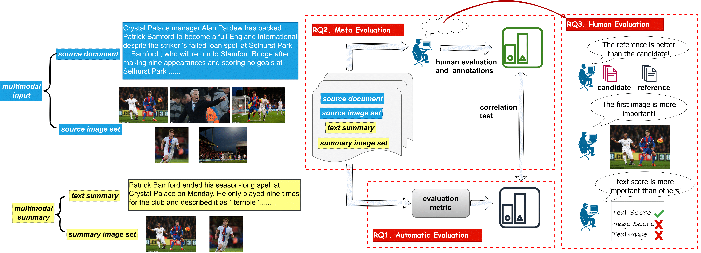

# Automatic, Meta and Human Evaluation for Multimodal Summarization with Multimodal Output

This repository provides the meta-evaluation dataset in the NAACL 2024 paper: [Automatic, Meta and Human Evaluation for Multimodal Summarization with Multimodal Output](https://aclanthology.org/2024.naacl-long.430/).


## Overview


MSMO (Multimodal Summarization with Multimodal Output) extracts the most important information from both source document and images to generate a multimodal summary. In this work, we investigate the following research questions:
1. **Automatic Evaluation**: How to properly evaluate the quality of a multimodal summary?
2. **Meta-Evaluation**: How to evaluate the evaluation metrics for multimodal summarization?
3. **Human Evaluation**: Are there any cognitive biases in human evaluation for multimodal summarization?


## Data

We release our meta-evaluation dataset in this Google Drive [link](https://drive.google.com/file/d/1GEO_lTEJvCEcSIYkdUW3sYFLA1m8imMV/view?usp=sharing), as well as the [annotations](https://docs.google.com/spreadsheets/d/1uAVje2Cy4RJYRSpseDYG4eci9iGyXrMVu9hNR5m6EPU/edit?usp=sharing).

The dataset is organized as follows:

```
meta_eval_data/
│── 0a24835c301afaa0e276aa7dcbc31667ff86aab9_bart/ # ID and system name
│ ├── source_img/                                  # source image set
│ ├── summary_img/                                 # summary image set
│ ├── source_doc.txt                               # source document
│ └── summary.txt                                  # text summary
│
│── 0a24835c301afaa0e276aa7dcbc31667ff86aab9_distilbart/
│ ├── source_img/
│ ├── summary_img/
│ ├── source_doc.txt
│ └── summary.txt
│⋮

```

There are 1,562 multimodal summarization examples in our meta-evaluation dataset (generated by 11 systems), where each example is annotated in (1) Relevance; (2) Coherence; (3) Consistency; (4) Fluency; (5) Summary Images Quality; (6) Text Summary-Summary Images Relevance; (7) Overall Quality.


## Citation

If you use this dataset in your research, we would appreciate it if you could cite it as:

```bibtex
@inproceedings{zhuang-etal-2024-automatic,
    title = "Automatic, Meta and Human Evaluation for Multimodal Summarization with Multimodal Output",
    author = "Zhuang, Haojie  and
      Zhang, Wei Emma  and
      Xie, Leon  and
      Chen, Weitong  and
      Yang, Jian  and
      Sheng, Quan",
    booktitle = "Proceedings of the 2024 Conference of the North American Chapter of the Association for Computational Linguistics: Human Language Technologies (Volume 1: Long Papers)",
    year = "2024"
}
```


## Acknowledgments

We thank the authors of [MSMO](https://aclanthology.org/D18-1448/) for providing the original MSMO dataset that makes this work possible.


